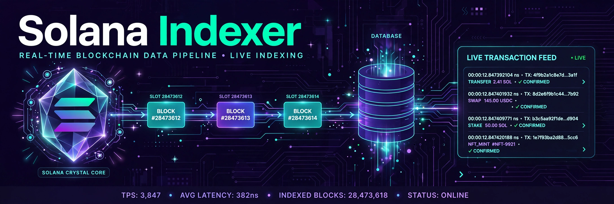
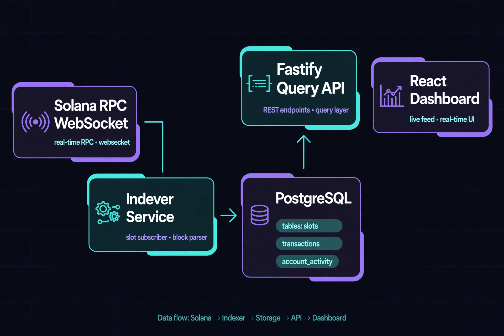

<div align="center">



# Solana Indexer

### Real-time Solana transaction and account watcher

[](LICENSE)


Subscribes to Solana slots over WebSocket RPC, parses every block, and stores
transactions, account activity, and slot metadata in Postgres. A Fastify query
API and a React live dashboard sit on top.

[Quickstart](#quickstart) • [Architecture](#architecture) • [API](#api)

</div>

---

## What it does

| | |
|---|---|
| 📡 **Live slot watcher** | WebSocket subscription to new slots. Backfills missed slots on start, then follows the chain in real time. |
| 🗄️ **Postgres pipeline** | Every transaction stored with signature, slot, fee, success flag, program IDs, and involved accounts. Account activity indexed for fast lookups. |
| 🔌 **Query API** | REST endpoints for transactions, account activity, slots, and stats, plus a WebSocket live feed that pushes new transactions as they land. |
| 📊 **Live dashboard** | React app with chain stats, latest transactions, account lookup, and a real-time transaction stream. |

## Architecture



```text
Solana RPC (WebSocket) → indexer → Postgres → API → dashboard
```

The indexer keeps `indexer_state.last_slot` in Postgres so restarts resume
where they left off instead of re-scanning.

## Quickstart

Prerequisites: Node 20+, Postgres 16.

```bash
# database
createdb solana_indexer
psql -d solana_indexer -f db/schema.sql

# indexer
cd indexer && npm install
DATABASE_URL=postgresql://localhost:5432/solana_indexer \
SOLANA_RPC_URL=https://api.devnet.solana.com \
BACKFILL=1 npm run dev

# api (new terminal)
cd api && npm install
DATABASE_URL=postgresql://localhost:5432/solana_indexer npm run dev

# dashboard (new terminal)
cd dashboard && npm install && npm run dev
```

Then open http://localhost:3000. The dashboard shows chain stats and streams
new transactions live as the indexer follows devnet.

Or with Docker Compose:

```bash
docker compose up --build
```

## API

```
GET /api/transactions?limit=50&account=<address>
GET /api/transactions/:signature
GET /api/accounts/:address/activity
GET /api/slots/latest
GET /api/stats
WS  /api/live          # pushes { type: 'tx', tx } for new transactions
```

## Database

| Table | Contents |
|---|---|
| `slots` | One row per indexed slot: blockhash, block time, tx count |
| `transactions` | Signature, slot, fee, success, program IDs, accounts |
| `account_activity` | Per-account index into transactions (signer/writable flags) |
| `indexer_state` | `last_slot` checkpoint for resume |

## Testing

```bash
cd indexer && npm test   # 5 tests: block parsing, program extraction
```

## License

MIT. See [LICENSE](LICENSE).
